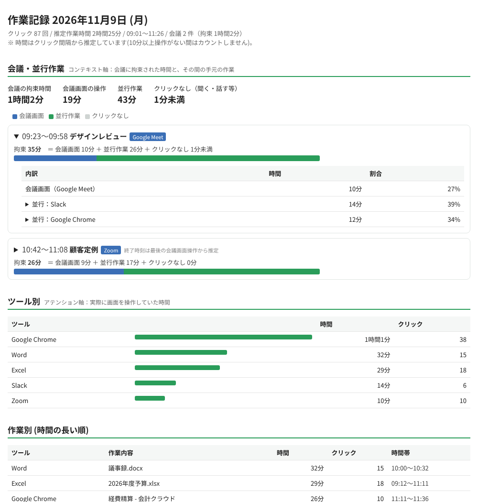

# TaskLogger

**Windows用の軽量な自動作業記録ツール。** マウスをクリックしたタイミングで「どのツールで」「何をしていたか」をCSVに記録し、1日のサマリーをHTMLで表示します。自分の作業を振り返るための個人用ツールです。

*A lightweight, click-driven activity logger for Windows. It records which app and which document/web page you were working on each time you click, and builds a daily HTML summary — including meeting time vs. what you did in parallel during meetings.*

## 特長

- **インストール不要**：Windowsに最初から入っている .NET Framework のC#コンパイラでビルドします
- **軽い**：クリックを待っている間は CPU をほぼ使いません。メモリは 20〜40MB ほどです
- **記録する内容**
  - ブラウザ：ページのタイトル・URL・クリックしたリンクやボタン
  - Excel・Wordなど：ファイル名・クリックしたボタン・セル番地
- **会議と並行作業を分けて集計**：Google Meet / Zoom / Teams の会議を自動で見つけて、次の2つの軸で集計します
  - **会議の拘束時間**：会議の開始から終了まで
  - **手元の操作時間**：会議中に別のツールで作業していた時間をツールごとに
- **データは手元に保存**：記録は自分のPCのCSVにだけ保存し、外部には送りません

## 記録される内容

| 列 | 例 |
|---|---|
| 日時 | 2026-11-04 10:15:32 |
| ツール | Excel / Word / Google Chrome / Microsoft Edge / エクスプローラー など |
| 作業内容 | `予算案.xlsx`、`議事録.docx`、ブラウザならページのタイトル |
| URL | ブラウザのみ（初期設定では `?` 以降を除く） |
| クリック対象 | 押したボタン名・タブ名・セル番地・リンク名など |
| 対象の種類 / ボタン / プロセス | ボタン、タブ項目…／左・右／EXCEL など |

**プライバシー**
- キー入力の内容は記録しません。
- パスワード欄をクリックした場合は「(パスワード欄)」とだけ記録します。
- シークレット／InPrivate ウィンドウと、パスワード管理アプリでの操作は記録しません。

## セットアップ

1. 右上の **Code → Download ZIP** でダウンロードして展開し、書き込みできる場所に置きます（例：`ドキュメント\TaskLogger`）。`Program Files` の中には置かないでください。
2. `build.bat` をダブルクリックすると `TaskLogger.exe` ができます。
3. `TaskLogger.exe` を起動すると、画面右下の通知領域に緑の丸いアイコンが出て記録が始まります。
   - 初回は SmartScreen の警告が出ることがあります。「詳細情報」→「実行」で起動できます。
4. 自動で起動したい場合は、アイコンを右クリックして「Windows起動時に自動で開始」にチェックを入れます。

**動作環境**：Windows 10 / 11（.NET Framework 4.x。Windowsに標準で入っています）

## 使い方（アイコンを右クリック）

- **今日のサマリーを表示**（アイコンのダブルクリックでも可）
- **今日のログ(CSV)を開く**：Excelで生データを確認できます。開いている間の記録は失われず、閉じた後にまとめて書き込まれます
- **一時停止 / 記録を再開**：アイコンが灰色の間は記録しません
- **終了**

過去の日のサマリーは、コマンドプロンプトで `TaskLogger.exe /summary 2026-11-03` のように日付を指定して開けます。ログは `logs\2026-11-04.csv` のように1日1ファイルで保存されます。

## 会議と並行作業の分離

サマリーを作るときにCSVを読み直して判定します（記録処理には影響しません）。

- **会議の検出**
  - Google Meet：タブ名「Meet - 会議名」
  - Zoom：「Zoom ミーティング」ウィンドウ
  - Teams：「今すぐ参加」のクリック
- **会議の終了**：「通話から退出」などの退出ボタンを押したとき、または会議画面の操作が `MeetingGapMinutes`（初期値20分）途切れたときです。後者は最後の会議画面の操作時刻を終了とします
- **会議名**：Meetはタブ名から取ります。Zoom/Teamsは、直前のZoomウィンドウ名や、Googleカレンダーでクリックした予定名から推定します
- **拘束時間の内訳**：会議画面＋並行作業（ツール別）＋クリックなし
- タイムラインには「会議画面」「会議中：会議名」のラベルが付きます

## 設定（TaskLogger.ini）

| 項目 | 説明 | 初期値 |
|---|---|---|
| `LogDir` | ログの保存先 | `logs` |
| `CaptureUrl` | ブラウザのURLを記録するか | `true` |
| `UrlDetail` | `full`（そのまま）/ `noquery`（`?`以降を除く）/ `domain`（ドメインのみ） | `noquery` |
| `CaptureElement` | クリックしたボタン名などを記録するか | `true` |
| `CaptureElementInBrowser` | ブラウザ内のクリック対象も記録するか（重いと感じたら `false`） | `true` |
| `RecordRightClick` | 右クリックも記録するか | `true` |
| `DedupSeconds` | 同じ場所への連続クリックをまとめる秒数 | `2` |
| `IdleCapMinutes` | サマリーで、この分数を超えて操作のない時間は作業時間に数えない | `10` |
| `MeetingGapMinutes` | 会議画面の操作がこの分数途切れたら会議の終了とみなす | `20` |
| `MeetingMergeMinutes` | 退出操作なしで途切れた同じ会議が、この分数以内に再開したら1つにまとめる | `60` |
| `ExcludeProcesses` | 記録しないアプリ（プロセス名をカンマ区切り） | パスワード管理アプリ等 |
| `PrivateKeywords` | タイトルにこの語を含むウィンドウは記録しない | InPrivate, シークレット 等 |

## 仕組み

- 低レベルマウスフック（`WH_MOUSE_LL`）でクリックを検知します。フックの中では位置とウィンドウを控えるだけにして、すぐに処理を返します。
- 画面の情報（ボタン名やURL）は、優先度の低い別スレッドで UI Automation を使って取得します。URLはページのタイトルが変わったときだけ読み取ります。
- サマリーでは、あるクリックから次のクリックまでの時間をそのクリックの作業時間とみなします（上限 `IdleCapMinutes`）。

## 制限事項

- **キーボード中心の作業**：記録のきっかけはクリックなので、キーボードだけで長く作業していた時間はサマリーで短めに出ます。
- **会議中の並行作業**：会議中に別のツールをクリックすると、次のクリックまでの時間（最大 `IdleCapMinutes`）はそのツールの作業として数えます。会議を聞いていた時間も含まれることがあるため、並行作業は多めに出る傾向があります。
- **Zoomの終了時刻**：退出ボタンを判別できないため、最後の会議画面の操作から推定します。
- **Teams**：判定ルールは実際のログでまだ十分に確かめていません。
- **管理者権限のアプリ**：その上でのクリックは、ボタン名などが取れないことがあります。
- **ブラウザのURL**：アドレスバーから読み取っているため、ブラウザのバージョンによっては取れないことがあります。その場合もページのタイトルは記録されます。

## ライセンス

[MIT License](LICENSE)
